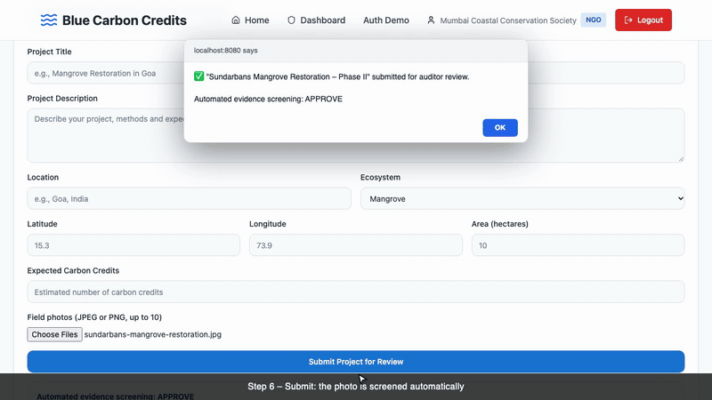

# 🌊 Blue Carbon Registry

**A blockchain registry and marketplace for blue carbon credits: carbon removed by mangroves, seagrass meadows and salt marshes.**

NGOs submit coastal restoration projects with photo evidence. Auditors review them and issue ERC-20 carbon credit tokens (**BCC**) on Ethereum. Companies buy those credits with ETH. Every issuance and sale is a public, verifiable on-chain transaction.

**Live demo:** _coming soon: paste your Vercel URL here after deploying (see [Deploy to Vercel](#deploy-to-vercel))_




_The full NGO → Auditor → Company flow on a local test chain, recorded with a stand-in wallet (see [Recording the demo](#recording-the-demo))._


---

## Why blue carbon?

Coastal ecosystems capture carbon several times faster per hectare than terrestrial forests. They are also among the most threatened habitats on Earth. Restoration projects can be financed by selling carbon credits, but traditional registries are opaque. It's hard to see who issued a credit, whether it was double-counted, or where it went.

This project puts the credit lifecycle on a public blockchain:

| Problem | How the registry addresses it |
|---|---|
| Opaque issuance | Credits can be minted **only** through `Marketplace.verifyNGO()`, which only the auditor (Marketplace admin) can call; every mint emits `CreditsMinted` |
| Double counting | Each BCC is an ERC-20 token, so it exists in exactly one wallet at a time |
| Slow, trust-based settlement | A smart contract swaps credits for ETH atomically: the NGO is paid and the buyer receives tokens in one transaction |
| Weak evidence | Uploaded field photos get a rule-based pre-check (resolution, EXIF GPS vs. project location, vegetation colour heuristic) before human review |

---

## How it works

```
 ┌──────────┐ 1. submit project  ┌────────────┐ 2. review evidence ┌──────────┐
 │   NGO    │ ─────────────────▶ │  Backend   │ ─────────────────▶ │ Auditor  │
 │          │   + geo-tagged     │ (Express)  │   auto-screening   │          │
 └──────────┘     photos         └────────────┘   report           └────┬─────┘
      │                                                                 │ 3. approve →
      │ 4. approve marketplace to sell BCC                              │    mint BCC to NGO
      ▼                                                                 ▼
 ┌───────────────────────────── Ethereum (Sepolia) ─────────────────────────────┐
 │  CarbonCreditToken (ERC-20 "BCC")  ◀──transferFrom──  Marketplace contract   │
 └──────────────────────────────────────────────────────────────────────────────┘
                                         ▲
                                         │ 5. executeTrade() + ETH
                                   ┌─────┴─────┐
                                   │  Company  │  receives BCC, NGO receives ETH
                                   └───────────┘
```

### Three roles

| Role | What they do |
|---|---|
| 🏛️ **NGO** | Submits restoration projects (location, area, ecosystem, species, photos), tracks review status, approves credits for sale |
| 🛡️ **Auditor** | Reviews pending projects alongside the automated evidence report, approves or rejects, and issues BCC to the NGO's wallet |
| 🏢 **Company** | Browses verified credits on the marketplace and buys them with ETH through MetaMask |

| NGO | Auditor | Company |
|---|---|---|
|  |  |  |

---

## Smart contracts

Source: [`blockchain-deployment/contracts`](blockchain-deployment/contracts)

**`CarbonCreditToken.sol`**: ERC-20 (`Blue Carbon Credit`, `BCC`) built on OpenZeppelin
- No initial supply; tokens are created only through `mint()`, restricted to the owner. **The owner is the Marketplace contract** (the deploy scripts call `transferOwnership`), so the only way to issue BCC is `Marketplace.verifyNGO()`
- `burn()` lets holders retire credits once they've been used to offset emissions

**`Marketplace.sol`**: registry and trading
- `registerNGO` / `registerCompany`: on-chain identities with IPFS document hashes
- `verifyNGO`: admin (the auditor wallet) sets NGO status (`Pending → Verified/Rejected`) and mints the allocated credits to the NGO
- `executeTrade(seller, buyer, amount, pdfHash)`: buyer sends ETH, contract moves BCC from seller to buyer and forwards ETH to seller, recording a trade receipt
- Events for every action (`NGORegistered`, `CreditsMinted`, `TradeExecuted`, …) so the full history can be indexed

### Live deployment (Sepolia testnet)

| Contract | Address |
|---|---|
| CarbonCreditToken (BCC) | [`0x025614e8Dc0b1eb488604D6f6C85982b85f9665B`](https://sepolia.etherscan.io/address/0x025614e8Dc0b1eb488604D6f6C85982b85f9665B) |
| Marketplace | [`0x4510c03bAb31E60fd99839A6eA3685f83dd3479D`](https://sepolia.etherscan.io/address/0x4510c03bAb31E60fd99839A6eA3685f83dd3479D) |

---

## Tech stack

| Layer | Tools |
|---|---|
| Smart contracts | Solidity 0.8.20, OpenZeppelin 5, Hardhat, Ethers v6 |
| Frontend | React 18, TypeScript, Vite, Tailwind CSS, shadcn/ui, TanStack Query, React Router |
| Web3 | MetaMask, ethers.js v6 (`BrowserProvider`, read-only `JsonRpcProvider`) |
| Backend | Node.js, Express, Multer (uploads), exifr + image-size + sharp (evidence screening) |
| Testing / CI | Vitest + Testing Library, Hardhat + Chai, GitHub Actions |
| Deploy | Docker / docker-compose + nginx, or Vercel (serverless `api/`) |

---

## Getting started

### Prerequisites
- Node.js 18+ (20 recommended)
- [MetaMask](https://metamask.io/) with some [Sepolia test ETH](https://sepoliafaucet.com/) to make real transactions

### 1. Clone and install
```bash
git clone https://github.com/08pranav/blue-carbon-registry-blockchain.git
cd blue-carbon-registry-blockchain
npm install
(cd backend && npm install)
```

### 2. Run
```bash
# terminal 1: API on http://localhost:3001
cd backend && npm start

# terminal 2: web app on http://localhost:8080
npm run dev
```
Open http://localhost:8080 and choose **Try NGO / Auditor / Company Demo**. The Vite dev server proxies `/api` to the backend, which starts with two sample projects waiting for an auditor. The marketplace starts empty: listings appear once an auditor approves a project.

> **Optional config:** copy `.env.example` to `.env` to change the API URL or feature flags. The app already points at the Sepolia contracts above.

### 3. End-to-end on-chain flow
0. **NGO**: *Submit New Project* with field photos. The backend screens them and the project appears in the auditor's queue.
1. **Auditor**: approve a pending project. MetaMask signs `verifyNGO(...)` (preceded by `registerNGO` if the NGO has no on-chain record yet), which mints the BCC to the NGO wallet.
   Approval records the issuance in the backend and creates a marketplace listing (default price 0.001 ETH per credit).
2. **NGO**: *Manage Credits* lets you set the quantity and ETH price of the listing, and *Approve Credits for On-Chain Sale* lets the Marketplace contract sell that many BCC.
3. **Company**: *Buy Credits* calls `Marketplace.executeTrade` with ETH. The NGO receives ETH and the company receives BCC; the backend then records the sale against the transaction hash.
4. Every step comes with a Sepolia Etherscan link.

### Testing with MetaMask
Step-by-step guide for first-time MetaMask users (Sepolia faucets, accounts per role, the full test script, Etherscan checks, troubleshooting, a local no-faucet option): [`docs/TESTING_WITH_METAMASK.md`](docs/TESTING_WITH_METAMASK.md).

### Project showcase
A detailed, fact-checked write-up of the architecture, contracts, engineering challenges and measured numbers (also usable as source material for posts): [`docs/PROJECT_SHOWCASE.md`](docs/PROJECT_SHOWCASE.md).

### Demo wallets
Each role must connect a specific MetaMask account. The defaults live in [`src/utils/fixedWallets.ts`](src/utils/fixedWallets.ts) and can be overridden in `.env` (see [`.env.example`](.env.example)):

| Role | Env var | Default |
|---|---|---|
| NGO | `VITE_NGO_WALLET` | `0x24cF2631Cd812089e14da2Bb6d7A7C5505258656` |
| Auditor | `VITE_AUDITOR_WALLET` | `0x179d59195f5771E907463986bCE98B0369e52837` (the Marketplace admin) |
| Company | `VITE_COMPANY_WALLET` | `0x179d59195f5771E907463986bCE98B0369e52837` |

The Auditor wallet must be the account that deployed the Marketplace, because only the Marketplace admin can call `verifyNGO`. The default Company wallet equals the Auditor wallet; set `VITE_COMPANY_WALLET` to give the Company its own account.

To check the live Sepolia deployment (read-only, no key needed): `node scripts/check-sepolia.mjs`.

### Recording the demo
`demo/` contains the scripts that produced the video above. They run the real app on a fresh local Hardhat chain, with a stand-in `window.ethereum` that forwards to the node instead of MetaMask, so every transaction is a real transaction with a real hash. Native `alert()` dialogs, which video capture cannot see, are drawn as in-page boxes showing the app's actual message.

```bash
npm install --no-save playwright && npx playwright install chromium   # one-time
demo/stack.sh start                    # new chain + deploy + empty backend + frontend (also resets state)
node demo/discover.cjs                 # optional: dump the page elements the script relies on (demo/field-map.md)
node demo/record-demo.cjs --rehearse   # check every selector and the on-chain steps, fast, no video
demo/stack.sh start                    # reset again (a run creates state)
node demo/record-demo.cjs              # record demo/blue-carbon-demo.webm
node demo/edit-videos.cjs              # build the mp4 (16:9, square, short), the GIF and chapters.txt with ffmpeg
demo/stack.sh stop
```
The video files are git-ignored; `demo/demo-preview.gif` and `demo/chapters.txt` are committed.

### Run with Docker
```bash
docker compose up --build   # frontend on http://localhost:3000 (nginx proxies /api), API on :3001
```

### Deploy to Vercel
The SPA is built by Vite and the API runs as one serverless function ([`api/index.js`](api/index.js)) that serves the same Express app as `backend/`. [`vercel.json`](vercel.json) installs both dependency sets and rewrites `/api/*` and `/uploads/*` to the function and everything else to `index.html`. The app calls same-origin `/api`, so `VITE_API_BASE_URL` stays empty.

```bash
npm i -g vercel
vercel login
vercel            # first run: link/create the project, accept the detected Vite settings
vercel --prod     # production deployment
```
Or import the GitHub repo at vercel.com/new (root directory `./`); no environment variables are required. Optional: `VITE_NGO_WALLET` / `VITE_AUDITOR_WALLET` / `VITE_COMPANY_WALLET` (build-time), `DEMO_NGO_WALLET`, `DEFAULT_PRICE_ETH`. After deploying, check `https://<your-app>.vercel.app/api/health` returns `{"status":"OK",...}` and that reloading `/login` still works.

Limits of this setup, because the backend keeps its data in memory:
- Data lives in one function instance and is lost on cold starts or when Vercel starts another instance, so projects can disappear between requests. Fine for a short demo, not for real use.
- Uploaded photos are written to `/tmp`, which instances don't share, and Vercel rejects request bodies over 4.5 MB: use small photos.
- For a demo that stays up, host `backend/` somewhere persistent (Render, Railway, Fly: it is a plain Node app with a `Dockerfile`), deploy only the SPA to Vercel and set `VITE_API_BASE_URL` to that host's URL.

---

## Smart contract development

```bash
cd blockchain-deployment
npm install
npx hardhat test             # run the contract test suite
npx hardhat node             # local chain (separate terminal)
npm run deploy:local         # deploy to the local chain
```

To deploy your own copy to Sepolia, copy `blockchain-deployment/.env.example` to `.env`, fill in `SEPOLIA_RPC_URL` and `SEPOLIA_PRIVATE_KEY` (use a throwaway testnet wallet, never commit it), then:
```bash
npm run deploy:sepolia       # writes deployments/sepolia.json and updates the frontend config
```

---

## Testing

```bash
npm run test:ci                              # frontend unit tests (Vitest)
(cd backend && npm test)                     # API tests (node:test)
(cd blockchain-deployment && npx hardhat test) # contract tests
npm run test:e2e-local                       # real wallet code vs. a local Hardhat node (starts one itself)
```

The contract suite deploys through the same `deployCore()` the deploy scripts use, and covers the full lifecycle: token ownership by the Marketplace, minting only through `verifyNGO`, NGO registration and verification, trading (ETH to seller, BCC to buyer), and the revert cases (direct mint, non-admin verify, missing approval, zero payment/amount).


---

## Project structure

```
├── src/                         React + TypeScript frontend
│   ├── pages/                   NGO / Auditor / Company dashboards, login, home
│   ├── contexts/                Role-based auth + blockchain state
│   ├── utils/TokenTransferService.ts   ethers.js: mint, approve, trade, balances
│   ├── blockchain-integration/  contract addresses, ABIs, network config
│   └── components/ui/           shadcn/ui components
├── backend/server.js            Express API: projects, uploads, evidence screening, marketplace
├── blockchain-deployment/       Hardhat project: contracts, deploy scripts, tests
├── api/                         Vercel serverless versions of the API
├── docs/                        Screenshots + archived design/setup notes
└── docker-compose.yml           Frontend (nginx) + backend containers
```

---

## Roadmap
- Pin project evidence and trade PDFs to IPFS (contract fields already store the hashes)
- Swap the in-memory backend store for a database
- Expose a public, read-only credit explorer built from on-chain events
- Add on-chain retirement certificates (burn → certificate NFT)
- Real wallet-based sign-in (SIWE) instead of demo role accounts

---

## Contributing
See [CONTRIBUTING.md](CONTRIBUTING.md). Issues and PRs are welcome.

## License
MIT
