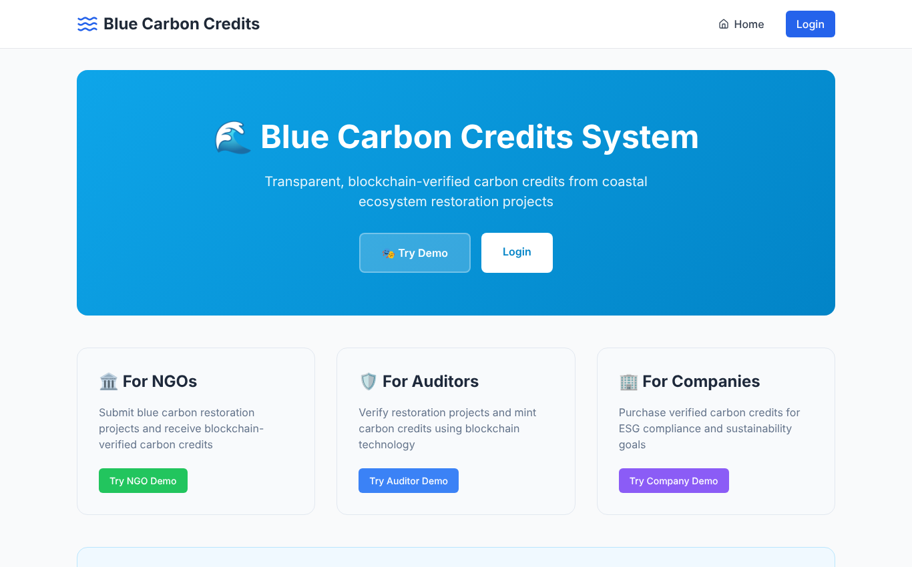
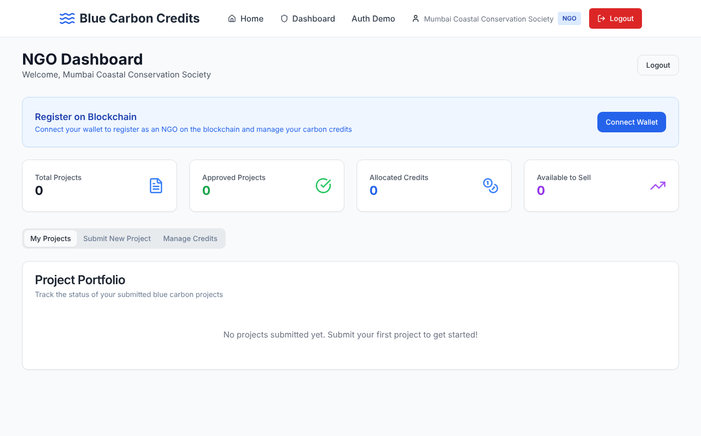
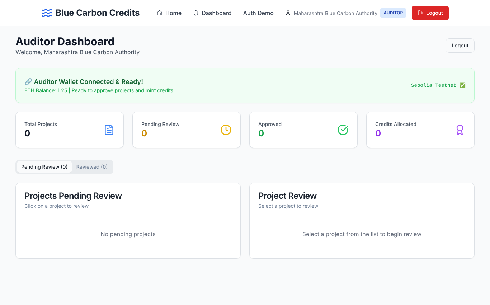
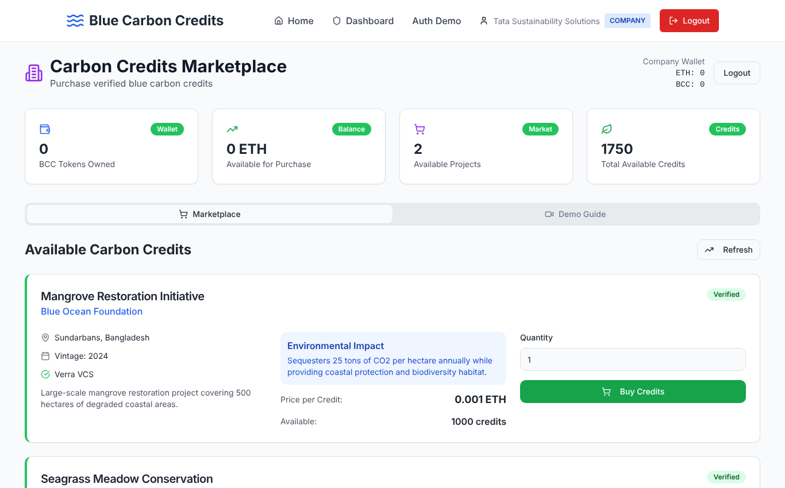

# 🌊 Blue Carbon Registry

**A blockchain registry and marketplace for blue carbon credits: carbon removed by mangroves, seagrass meadows and salt marshes.**

NGOs submit coastal restoration projects with photo evidence. Auditors review them and mint ERC-20 carbon credit tokens (**BCC**) on Ethereum. Companies buy those credits with ETH. Every issuance and sale is a public, verifiable on-chain transaction.




---

## Why blue carbon?

Coastal ecosystems capture carbon several times faster per hectare than terrestrial forests. They are also among the most threatened habitats on Earth. Restoration projects can be financed by selling carbon credits, but traditional registries are opaque. It's hard to see who issued a credit, whether it was double-counted, or where it went.

This project puts the credit lifecycle on a public blockchain:

| Problem | How the registry addresses it |
|---|---|
| Opaque issuance | Credits are minted **only** by the auditor's wallet (contract owner); every mint is an on-chain event |
| Double counting | Each BCC is an ERC-20 token, so it exists in exactly one wallet at a time |
| Slow, trust-based settlement | A smart contract swaps credits for ETH atomically: the NGO is paid and the buyer receives tokens in one transaction |
| Weak evidence | Uploaded field photos are automatically screened (resolution, EXIF GPS vs. project location, vegetation colour signal) before human review |

---

## How it works

```
 ┌──────────┐ 1. submit project  ┌────────────┐ 2. review evidence ┌──────────┐
 │   NGO    │ ─────────────────▶ │  Backend   │ ─────────────────▶ │ Auditor  │
 │          │   + geo-tagged     │ (Express)  │   auto-screening   │          │
 └──────────┘     photos         └────────────┘   report           └────┬─────┘
      │                                                                 │ 3. approve →
      │ 4. approve marketplace to sell BCC                              │    mint BCC to NGO
      ▼                                                                 ▼
 ┌───────────────────────────── Ethereum (Sepolia) ─────────────────────────────┐
 │  CarbonCreditToken (ERC-20 "BCC")  ◀──transferFrom──  Marketplace contract   │
 └──────────────────────────────────────────────────────────────────────────────┘
                                         ▲
                                         │ 5. executeTrade() + ETH
                                   ┌─────┴─────┐
                                   │  Company  │  receives BCC, NGO receives ETH
                                   └───────────┘
```

### Three roles

| Role | What they do |
|---|---|
| 🏛️ **NGO** | Submits restoration projects (location, area, ecosystem, species, photos), tracks review status, approves credits for sale |
| 🛡️ **Auditor** | Reviews pending projects alongside the automated evidence report, approves or rejects, and mints BCC to the NGO's wallet |
| 🏢 **Company** | Browses verified credits on the marketplace and buys them with ETH through MetaMask |

| NGO | Auditor | Company |
|---|---|---|
|  |  |  |

---

## Smart contracts

Source: [`blockchain-deployment/contracts`](blockchain-deployment/contracts)

**`CarbonCreditToken.sol`**: ERC-20 (`Blue Carbon Credit`, `BCC`) built on OpenZeppelin
- No initial supply; tokens are created only through `mint()`, restricted to the owner (the auditor)
- `burn()` lets holders retire credits once they've been used to offset emissions

**`Marketplace.sol`**: registry and trading
- `registerNGO` / `registerCompany`: on-chain identities with IPFS document hashes
- `verifyNGO`: admin sets NGO status (`Pending → Verified/Rejected`) and can allocate credits
- `executeTrade(seller, buyer, amount, pdfHash)`: buyer sends ETH, contract moves BCC from seller to buyer and forwards ETH to seller, recording a trade receipt
- Events for every action (`NGORegistered`, `CreditsMinted`, `TradeExecuted`, …) so the full history can be indexed

### Live deployment (Sepolia testnet)

| Contract | Address |
|---|---|
| CarbonCreditToken (BCC) | [`0x025614e8Dc0b1eb488604D6f6C85982b85f9665B`](https://sepolia.etherscan.io/address/0x025614e8Dc0b1eb488604D6f6C85982b85f9665B) |
| Marketplace | [`0x4510c03bAb31E60fd99839A6eA3685f83dd3479D`](https://sepolia.etherscan.io/address/0x4510c03bAb31E60fd99839A6eA3685f83dd3479D) |

---

## Tech stack

| Layer | Tools |
|---|---|
| Smart contracts | Solidity 0.8.20, OpenZeppelin 5, Hardhat, Ethers v6 |
| Frontend | React 18, TypeScript, Vite, Tailwind CSS, shadcn/ui, TanStack Query, React Router |
| Web3 | MetaMask, ethers.js (`BrowserProvider`), wagmi/viem |
| Backend | Node.js, Express, Multer (uploads), exifr + image-size + sharp (evidence screening) |
| Testing / CI | Vitest + Testing Library, Hardhat + Chai, GitHub Actions |
| Deploy | Docker / docker-compose + nginx, or Vercel (serverless `api/`) |

---

## Getting started

### Prerequisites
- Node.js 18+ (20 recommended)
- [MetaMask](https://metamask.io/) with some [Sepolia test ETH](https://sepoliafaucet.com/) to make real transactions

### 1. Clone and install
```bash
git clone https://github.com/08pranav/blue-carbon-registry-blockchain.git
cd blue-carbon-registry-blockchain
npm install
(cd backend && npm install)
```

### 2. Run
```bash
# terminal 1: API on http://localhost:3001
cd backend && npm start

# terminal 2: web app on http://localhost:8080
npm run dev
```
Open http://localhost:8080 and choose **Try NGO / Auditor / Company Demo**. The backend comes with sample projects and marketplace listings.

> **Optional config:** copy `.env.example` to `.env` to change the API URL or feature flags. The app already points at the Sepolia contracts above.

### 3. End-to-end on-chain flow
1. **Auditor**: approve a pending project and mint BCC to the NGO wallet (MetaMask signs the `mint` transaction).
2. **NGO**: *Manage Credits → Approve Credits for On-Chain Sale* lets the Marketplace sell that many BCC.
3. **Company**: *Buy Credits* calls `Marketplace.executeTrade` with ETH. The NGO receives ETH and the company receives BCC.
4. Every step comes with a Sepolia Etherscan link.

### Run with Docker
```bash
docker-compose up --build   # frontend on :3000, API on :3001
```

---

## Smart contract development

```bash
cd blockchain-deployment
npm install
npx hardhat test             # run the contract test suite
npx hardhat node             # local chain (separate terminal)
npm run deploy:local         # deploy to the local chain
```

To deploy your own copy to Sepolia, copy `blockchain-deployment/.env.example` to `.env`, fill in `SEPOLIA_RPC_URL` and `SEPOLIA_PRIVATE_KEY` (use a throwaway testnet wallet, never commit it), then:
```bash
npm run deploy:sepolia       # writes deployments/sepolia.json and updates the frontend config
```

---

## Testing

```bash
npm run test:ci                              # frontend unit tests (Vitest)
cd blockchain-deployment && npx hardhat test # contract tests
```

The contract suite covers the full lifecycle: minting permissions, NGO registration and verification, minting on verification, trading (ETH to seller, BCC to buyer), and the revert cases (unauthorised mint, missing approval, zero payment/amount).

```
  Blue Carbon Registry
    CarbonCreditToken
      ✔ has the right name/symbol and starts with zero supply
      ✔ lets only the owner (auditor/admin) mint
      ✔ lets holders burn (retire) their credits
    Marketplace registry
      ✔ registers an NGO as Pending and blocks duplicates
      ✔ only admin can verify an NGO
      ✔ mints on verification once the marketplace owns the token
      ✔ registers companies
    Trading
      ✔ reverts if the NGO has not approved the marketplace
      ✔ moves BCC to the company and ETH to the NGO
      ✔ requires payment and a positive amount

  10 passing
```

---

## Project structure

```
├── src/                         React + TypeScript frontend
│   ├── pages/                   NGO / Auditor / Company dashboards, login, home
│   ├── contexts/                Role-based auth + blockchain state
│   ├── utils/TokenTransferService.ts   ethers.js: mint, approve, trade, balances
│   ├── blockchain-integration/  contract addresses, ABIs, network config
│   └── components/ui/           shadcn/ui components
├── backend/server.js            Express API: projects, uploads, evidence screening, marketplace
├── blockchain-deployment/       Hardhat project: contracts, deploy scripts, tests
├── api/                         Vercel serverless versions of the API
├── docs/                        Screenshots + archived design/setup notes
└── docker-compose.yml           Frontend (nginx) + backend containers
```

---

## Roadmap
- Pin project evidence and trade PDFs to IPFS (contract fields already store the hashes)
- Swap the in-memory backend store for a database
- Expose a public, read-only credit explorer built from on-chain events
- Add on-chain retirement certificates (burn → certificate NFT)
- Real wallet-based sign-in (SIWE) instead of demo role accounts

---

## Contributing
See [CONTRIBUTING.md](CONTRIBUTING.md). Issues and PRs are welcome.

## License
MIT
