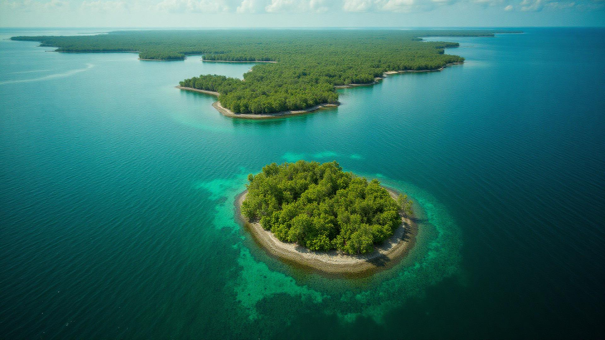

# 🌊 Blue Carbon Registry & MRV System

A blockchain-powered platform for monitoring, reporting, and verifying blue carbon ecosystem restoration projects in India's coastal regions. This system enables transparent, immutable tracking of coastal restoration projects and facilitates the generation and trading of verified carbon credits.



## 🌟 Overview

Blue carbon ecosystems - mangroves, seagrass beds, and salt marshes - are among the most carbon-rich environments on Earth. This platform provides a comprehensive solution for:

- **Project Registration**: Register coastal restoration projects with detailed metadata
- **MRV System**: Monitoring, Reporting, and Verification of restoration progress
- **Blockchain Verification**: Immutable record-keeping on blockchain networks
- **Carbon Credit Generation**: Automated tokenization of verified carbon credits
- **Marketplace**: Trading platform for verified blue carbon credits
- **Community Engagement**: Support for NGOs, panchayats, and community organizations

## 🚀 Key Features

### 📊 **Registry Dashboard**
- Real-time project statistics and analytics
- Interactive project listings with verification status
- Progress tracking with visual indicators
- Organization type categorization (NGO, Panchayat, Community, Government)

### 🔐 **Blockchain Integration**
- Immutable project records on blockchain
- Transparent verification history
- Tokenized carbon credits with smart contracts
- Fraud prevention through cryptographic verification

### 📈 **Carbon Credits Marketplace**
- Buy and sell verified blue carbon credits
- Real-time pricing and market analytics
- Transaction history and portfolio management
- INR and USD pricing support

### 🔍 **MRV (Monitoring, Reporting, Verification)**
- Systematic data collection workflows
- Photo and drone footage documentation
- Third-party verification processes
- Automated compliance checking

### 👥 **Multi-Stakeholder Support**
- **NGOs**: Submit and manage restoration projects
- **Panchayats**: Community-driven coastal conservation
- **Government**: Regulatory oversight and administration
- **Private Sector**: Carbon credit purchasing and investment

### 📱 **Admin Dashboard**
- User management and verification
- Pending verification queue
- Blockchain transaction monitoring
- System analytics and reporting

## 🛠️ Technology Stack

- **Frontend**: React 18 + TypeScript
- **Build Tool**: Vite
- **UI Framework**: shadcn/ui + Tailwind CSS
- **Routing**: React Router v6
- **State Management**: TanStack Query
- **Icons**: Lucide React
- **Styling**: Tailwind CSS with custom theme
- **Package Manager**: Bun

## 📦 Installation & Setup

### Prerequisites
- Node.js 18+ or Bun runtime
- Git

### Local Development

```bash
# Clone the repository
git clone <YOUR_GIT_URL>
cd blue-carbon-new

# Install dependencies
bun install
# or with npm
npm install

# Start development server
bun run dev
# or with npm
npm run dev

# Build for production
bun run build
# or with npm
npm run build
```

### Environment Setup

The application works out of the box with mock data. For production deployment, you would need to configure:

- Blockchain network connections
- Database connections
- API endpoints
- Authentication providers

## 🏗️ Project Structure

```
src/
├── components/          # Reusable UI components
│   ├── ui/             # shadcn/ui components
│   ├── HeroSection.tsx # Landing page hero
│   ├── Header.tsx      # Navigation header
│   ├── RegistryDashboard.tsx
│   ├── CarbonCreditsTracker.tsx
│   └── DataUploadForm.tsx
├── pages/              # Route components
│   ├── Home.tsx        # Landing page
│   ├── Registry.tsx    # Project registry
│   ├── Projects.tsx    # Project details
│   ├── Marketplace.tsx # Carbon credits trading
│   ├── Submit.tsx      # Data submission
│   ├── Admin.tsx       # Admin dashboard
│   └── Docs.tsx        # Documentation
├── hooks/              # Custom React hooks
├── lib/                # Utility functions
└── assets/             # Static assets
```

## 🌐 Application Routes

- `/` - Landing page with overview statistics
- `/registry` - Browse all registered projects
- `/projects` - Project listings and details
- `/projects/:id` - Individual project details
- `/marketplace` - Carbon credits marketplace
- `/submit` - Submit new project data
- `/admin` - Administrative dashboard
- `/docs` - API documentation and guides

## 📊 Sample Data

The application includes comprehensive mock data for demonstration:

- **3 Sample Projects**: Sundarbans, Kerala Backwater, Odisha Deltaic restoration
- **Carbon Credits**: 51,010+ tokenized credits across projects
- **Coverage Area**: 396.5+ hectares of restored coastal ecosystems
- **Verification Status**: Mix of verified, pending, and in-progress projects

## 🔧 Configuration

### Tailwind Theme
Custom color palette optimized for blue carbon branding:
- **Ocean**: Blue tones for water/marine themes
- **Nature**: Green tones for ecosystem themes
- **Gradient**: Custom gradients for visual appeal

### Component Library
Built on shadcn/ui with custom styling:
- Cards, Buttons, Badges, Forms
- Data tables and charts
- Navigation and layout components

## 🌍 Use Cases

### For NGOs
- Register restoration projects
- Upload monitoring data
- Track verification progress
- Generate carbon credits

### For Government
- Oversee project compliance
- Monitor restoration progress
- Verify carbon credit claims
- Generate policy insights

### For Communities
- Participate in local restoration
- Access technical documentation
- Track community impact
- Benefit from carbon revenue

### For Private Sector
- Purchase verified carbon credits
- Offset carbon emissions
- Support coastal restoration
- Access ESG reporting data

## 🚀 Deployment

### Development
```bash
bun run dev
```

### Production Build
```bash
bun run build
bun run preview
```

### Deployment Platforms
- **Vercel**: Optimal for React/Vite applications
- **Netlify**: Easy static site deployment  
- **Railway**: Full-stack deployment with backend
- **AWS S3 + CloudFront**: Enterprise static hosting

## 🤝 Contributing

This project supports India's coastal restoration efforts and climate goals. Contributions are welcome for:

- Additional ecosystem types (coral reefs, kelp forests)
- Enhanced MRV methodologies
- Blockchain integration improvements
- Mobile responsiveness
- Accessibility features

## 📄 License

This project is built for the Smart India Hackathon (SIH) focusing on blue carbon ecosystem restoration and blockchain-based carbon credit generation.

## 🔗 Links & Resources

- **Blue Carbon Initiative**: Understanding blue carbon ecosystems
- **IPCC Wetlands Supplement**: Methodological guidance
- **India's NDC**: National climate commitments
- **Coastal Regulation Zone**: Environmental guidelines

---

**Built with ❤️ for India's coastal ecosystems and climate resilience**
